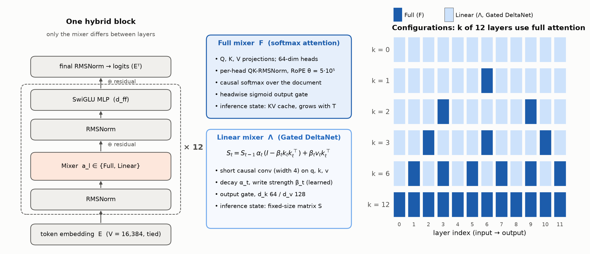
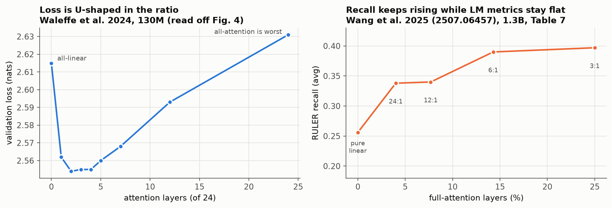
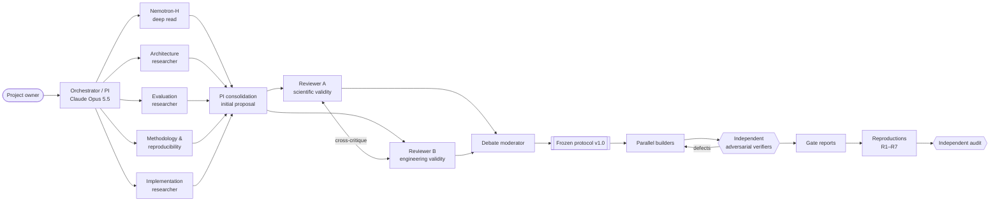
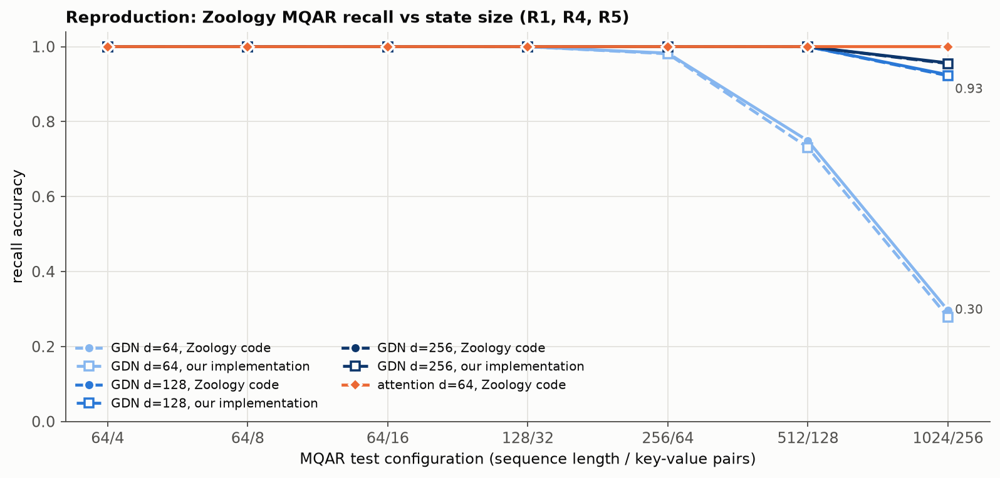
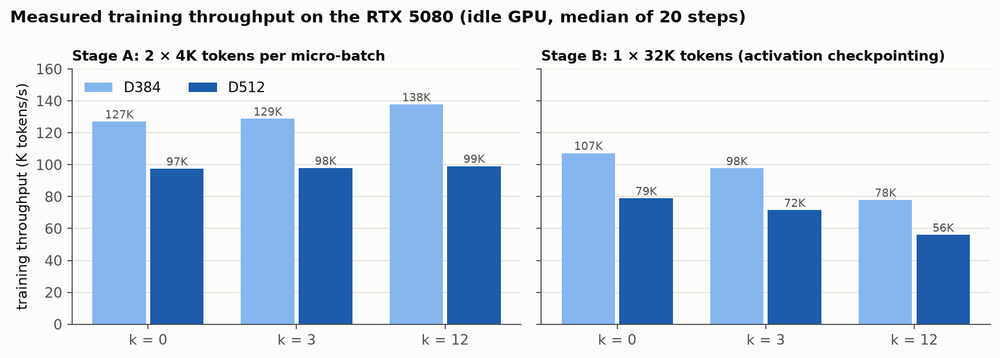
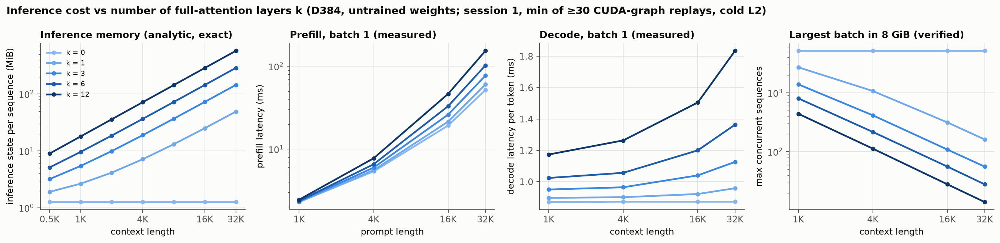

# How Much Full Attention Does Long Context Need?

**A controlled study of hybrid linear/full attention ratios in small language models**

IE624 course project. A single-GPU research programme with pre-registered hypotheses, reproduced baselines and full provenance.

> **Status (2026-11-11): pre-pilot.**
> - The literature study, experimental design, independent review, infrastructure and reproduction of published results are done.
> - **No main-study training run has happened yet**, so there are no findings on hypotheses H1–H6.
> - The work is held at the gate (G-RV) that opens the pilot runs (S2 FEAS). See [Current status](#current-status) and [`reports/STATUS.md`](reports/STATUS.md).

---

## Contents
1. [Abstract](#abstract)
2. [Research questions and hypotheses](#research-questions-and-hypotheses)
3. [What prior work already shows](#what-prior-work-already-shows)
4. [Study design](#study-design)
5. [How the research was run](#how-the-research-was-run)
6. [Timeline](#timeline)
7. [Results so far](#results-so-far)
8. [Current status and next steps](#current-status)
9. [Repository structure](#repository-structure)
10. [Setup and reproduction](#setup-and-reproduction)
11. [Document map](#document-map)
12. [Limitations and known issues](#limitations-and-known-issues)
13. [Acknowledgements](#acknowledgements)

---

## Abstract

Transformer language models use self-attention to capture long-range dependencies. Full attention costs time quadratic in sequence length, and its key-value (KV) cache grows linearly with it, so it gets expensive at long context. Linear attention keeps a fixed-size recurrent state instead. Whether that state preserves retrieval and reasoning over long inputs is an open question. Recent hybrid models (Nemotron-H, Jamba, Griffin, Qwen3-Next, MiniMax-01, Kimi Linear) mix a few full-attention layers with many linear or state-space layers, in fixed ratios such as 3:1 or 7:1. Our literature review found that **these ratios are inherited rather than derived from long-context evidence.** For example, Nemotron-H's "~8% attention" is quoted from prior work, not tested.

The study varies that ratio directly. We train a family of small language models (≈ 28M or ≈ 49M parameters, 12 layers) on one GPU. Data, data order, parameter count and training recipe are identical across the family. The only thing that changes is **k, the number of the 12 token-mixing layers that use full softmax attention**. The remaining 12 − k layers use **Gated DeltaNet**, a gated delta-rule linear-attention layer. Each model is evaluated on long-context retrieval, multi-hop key chains and frequency aggregation at 1K–32K tokens, with every length inside the training length. We also measure inference-state memory (KV cache vs recurrent state), prefill latency and decode throughput.

The intended output is a capability-vs-cost frontier. It answers how much long-context accuracy is lost per byte of inference memory saved, and whether a small number of full-attention layers recovers most of what full attention provides. We discuss what this means for long-running AI agents, which depend on long context.

<p align="center"></p>

*Figure 1. The model family. Every model has the same 12 pre-norm blocks. The **only** per-layer difference is the token mixer: full softmax attention (F) or Gated DeltaNet linear attention (Λ). The full-attention layers are spaced evenly, and k is the number of them.*

## Research questions and hypotheses

| | Question | How we measure it |
|---|---|---|
| **RQ-A** Composition | How does the number of full-attention layers affect long-context performance when everything else is held fixed? | Family scores S_f(k, T) for k ∈ {0, 1, 2, 3, 6, 12} and T ∈ {1K … 32K} |
| **RQ-B** Placement | Does *where* the full layers sit matter, independently of how many there are? | Early / middle / late patterns at a fixed k* |
| **RQ-C** Task dependence | Do retrieval, multi-hop and aggregation need different amounts of full attention? | Normalised recovery R_f(k) per task family |
| **RQ-D** Cost | How do capability differences relate to inference memory, prefill latency and decode throughput? | Analytic costs (primary) plus measured costs on an idle GPU (secondary) |

The hypotheses below are pre-registered (`reports/experimental_protocol.md` §2). Each has a stated test, falsification rule and direction.

| ID | Hypothesis | Pre-registered test |
|---|---|---|
| **H1** | A small proportion of full attention recovers most of the long-context performance | Recovery R(3) ≥ 0.8 of the gap from k=0 to k=12 on the 16K/32K retrieval cell. Paired per-seed t-test, Holm-corrected |
| H1-min | One full layer suffices | The same test at k = 1 |
| H2 | Diminishing returns | Descriptive: isotonic and saturating fits, and k80 |
| H3 | The required amount depends on task type | Paired D₃ = R_ret(3) − R_hop(3) |
| H4 | Placement matters independently of proportion | Early vs middle vs late contrasts at k* |
| H5 | The benefit of full attention grows with context length | Per-seed slope of the k=12 vs k=0 gap against log₂ T |
| H6 | Hybrids reach a cost/capability region neither pure model reaches | Hull margin (descriptive). H6′ tests recurrent state vs KV cache at matched memory |

Predictions written down before any run (never used in a test): k = 1 recovers little retrieval; R(3) lies in 0.6–1.1; multi-hop recovers less than retrieval; the gap grows with length.

## What prior work already shows

Five specialist research agents read the papers, configs and code. The full review is [`reports/literature/literature_review.md`](reports/literature/literature_review.md); the database is [`literature_db.yaml`](reports/literature/literature_db.yaml), with about 190 KB of structured entries and an access level recorded per source.

- **Production ratios are inherited, not derived.**
  - Nemotron-H (arXiv 2504.03624) takes its ~8% attention share from Waleffe et al. 2024 ("as suggested by prior work"). Its Transformer comparison also changes depth and position encoding, so **it is not a controlled ratio experiment.**
  - In the released configs, the 8B model has attention at layers 7, 18, 29 and 40. We found two mismatches between configs and paper.
  - MiniMax-01 (7:1) and Qwen3-Next (3:1) publish no sweep behind their ratios.
- **Controlled sweeps agree on loss.** The sweeps are Waleffe 130M, Mamba-2, Bae et al., Wang et al. 2507.06457 and Kimi Linear.
  - Loss flattens once about 4–10% of layers are attention.
  - The first attention layer captures most of the gain.
  - An all-attention model is often *worse* than the best hybrid.
- **Retrieval is not flat in the ratio.** In Wang et al. at 1.3B, averaged recall is 0.256 for pure linear, then 0.338 / 0.390 / 0.397 at 24:1 / 6:1 / 3:1, while loss barely moves.
- **Length × ratio is almost untested.** The only evidence is Nemotron-Flash (2511.18890): keeping one full-attention layer instead of three drops needle retrieval at 32K from 0.69 to 0.32.
- **Main confounds:**
  - Position encoding: removing it from the attention layers (NoPE) raised one 0.22B hybrid's retrieval at 16K from 49.6 to 67.8.
  - Small-scale all-attention models are sometimes handicapped.
  - Kernel maturity differs (FA2 at ≈ 81% of peak vs the Gated DeltaNet kernel at ≈ 10%).
  - Natural-language benchmarks score at the floor for 20–60M models.
<p align="center"></p>

*Figure 2. What earlier controlled sweeps found (values transcribed from the papers; Waleffe's are read off a figure and are approximate). Loss barely cares about the ratio once a few attention layers exist, but long-context recall keeps improving. That gap between loss and recall is the motivation for this study.*

- **Gap we address.**
  - A full 0→12 sweep in one controlled, seed-replicated design.
  - Results per task family, length-resolved with every length inside the training length.
  - Placement trained from scratch, measured on retrieval.
  - A measured cost frontier on one implementation, at 20–60M parameters.
  - Honest framing: an **extension and partial replication** of Wang et al. and Waleffe et al.

## Study design

The frozen protocol is [`reports/experimental_protocol.md`](reports/experimental_protocol.md) (v1.0, about 1,100 lines), amended by logged deviations DEV-01…04. A condensed step-by-step version is [`docs/METHODOLOGY.md`](docs/METHODOLOGY.md).

**Model family.**
- a = (a₀ … a₁₁) ∈ {F, Λ}¹². Each block is a pre-norm mixer followed by a SwiGLU MLP; the embeddings are tied, there are no biases, and the only per-layer difference is the mixer.
- **F (full).** Multi-head attention with 64-dim heads, per-head QK-RMSNorm, RoPE θ = 5·10⁵ reset per document, and a headwise sigmoid output gate.
- **Λ (linear).** `fla.layers.GatedDeltaNet` (fla 0.6.0) with head_dim 64, expand_v 2, an output gate and a short conv of width 4.
- **Parameter matching.** Non-embedding parameter counts differ by at most 0.094% (D512) and 0.137% (D384) across k.

| Scale | d | d_ff | Vocab | Params (total) | Stage-A tokens |
|---|---|---|---|---|---|
| D384 | 384 | 1,024 | 16,384 | ≈ 27.6M | 0.6B |
| D512 | 512 | 1,536 | 16,384 | ≈ 49.4M | 0.8B |

**Configurations.** The full-attention layers are spaced evenly.
- C0 `------------`
- C1 `------A-----`
- C2 `---A-----A--`
- C3 `--A---A---A-`
- C6 `-A-A-A-A-A-A`
- C12 `AAAAAAAAAAAA`

**Controls.**
- Attention with a short convolution (F_gc), to remove the asymmetry that only the linear layers have a convolution.
- NoPE on the full layers.
- GDN-E, a wider-head linear model, to test whether recurrent state is worth more than KV cache.
- Tier-C extras: GLA and conv-free GDN.

**Data and training.**
- Data: FineWeb-Edu (sample-10BT) plus PG19 books, both pinned to exact dataset revisions.
- Tokenizer: our own 16K byte-level BPE with single-digit isolation.
- Stage A (4K, 85/15 mix) → Stage B at 32K (60% book windows) → an identical **task-exposure fine-tune (TEF)** on synthetic long-context tasks. Without that exposure, models this small can't express long-context ability at all.
- Optimiser: AdamW (0.9, 0.95), weight decay 0.1, z-loss, bf16 autocast.
- LR: chosen by a minimax-regret sweep over k ∈ {0, 3, 12}.

**Evaluation.**
- Fill-in-the-blank items, each exactly T tokens long and built in token space, with frozen item files checked by SHA-256.
- Task families:
  - **Retrieval:** R1 facts with distractors; R-load with N up to 1,024 facts.
  - **Multi-hop:** M-hop shuffled key chains, h ≤ 4.
  - **Aggregation:** A-freq frequency comparison.
- Diagnostics: distance vs filler, recency, oracle position, attention mass, and zero-shot per-position loss and copy-after-gap.
- Metrics: EM (exact match, teacher-forced) primary; gold log-prob and rank accuracy secondary.

**Statistics, fixed before any result.**
- 4–5 training seeds per configuration.
- Seed streams are shared across k, so seeds pair across configurations.
- Recovery contrast L_k = S_k − 0.2·S₀ − 0.8·S₁₂.
- Holm correction over {H1, H1-min, H3, H5a}.
- Hierarchical paired bootstrap as a sensitivity check.
- A seed-addition rule that ignores the observed effect.
- Four guards against falsely declaring H1 falsified.
- Quantitative go/no-go gates (G0, G-RP, G-RV, FEAS, G-LR, G5, G-FULL, G-REF).

```mermaid
flowchart LR
    S0[S0 infrastructure<br/>VT-01…25] -->|G0| S1[S1 reproductions<br/>R1–R10]
    S1 -->|G-RP, G-RV| S2[S2 FEAS pilots<br/>scale, Stage-B budget,<br/>SSMax, TEF mix]
    S2 -->|FEAS rules| S3[S3 LR sweep]
    S3 -->|G-LR| G5[[G5 freeze<br/>items · code · configs]]
    G5 --> S4[S4 core runs<br/>k ∈ 0,1,3,12 × seeds]
    S4 -->|G-FULL, G-REF| S5[S5 controls<br/>conv, NoPE, dose]
    S5 --> S6[S6 evaluation<br/>+ cost benchmarks]
    S6 -->|Tier-A decision| S7[S7 Tier B<br/>k = 2, 6 · placement · GDN-E]
    S7 --> R[Analysis & report]
    style S0 fill:#cde2fb
    style S1 fill:#cde2fb
```


*Figure 3. Staged plan. Each arrow is a quantitative go/no-go gate fixed before the stage runs. The shaded stages are complete.*

**Budget.** About 86 GPU-h for the essential tier at D384, or about 144 at D512. On an idle GPU, measured throughput is 1.3–2.4× higher than the planning rates.

## How the research was run

The project is run as a small "research organisation" of AI agents (Claude Opus 5.5) orchestrated from Claude Code. The repository is its external memory.



1. **Specialist research agents**, five in parallel: a Nemotron-H deep read, attention architectures, long-context evaluation, methodology and reproducibility, and implementation/repositories.
2. **PI consolidation** into an initial proposal.
3. **Two adversarial reviewers**: A on scientific validity, B on engineering. Each critiqued the proposal, wrote an independent design and named the minimum experiment that would falsify H1. They then cross-critiqued each other's designs, and a moderator resolved 29 issues (I-01…I-29) and logged the 16 left open (U-01…U-16). See [`reports/reviews/debate_record.md`](reports/reviews/debate_record.md).
4. **Frozen protocol**, a decision log (D000–D091, DEV-01…04, P001–P004) and a competing-explanations register.
5. **Parallel builders**, one per module (models, data, eval, training, analysis), then an integrator, then **independent adversarial verifiers** with fix loops. Verifiers never review their own code.
6. **Reproduction before novelty.** Published results are reproduced with the original code and with ours, swapping one component at a time, against pass criteria fixed in advance.
7. **Integrity rules.**
   - A pre-registered criterion is never restated after its test has run.
   - Failures are recorded as "NOT PASSED as registered", with a named residual risk or a newly pre-registered check.
   - No result is tuned towards a published number.

## Timeline

The full log, with commits, is [`docs/TIMELINE.md`](docs/TIMELINE.md).

| Date (IST) | Milestone |
|---|---|
| 2026-11-07 | Repository created with the project idea |
| 2026-11-09 am | Project framing: abstract, RQs, hypotheses, repository skeleton, decision log |
| 2026-11-09 12:00–15:35 | **Stages 1–3:** five research agents, PI proposal, two adversarial reviewers with debate, protocol v1.0 frozen |
| 2026-11-09 15:40–22:10 | **S0 build:** six parallel builders (models, data, eval, training, analysis, Zoology reproduction). 22 GB of data downloaded and pinned; tokenizer and 17 GB of token stores built |
| 2026-11-09 17:35–21:00 | **R1:** Zoology MQAR reproduced with Zoology's own code (16 runs) |
| 2026-11-09 23:18 | Reproduction programme designed (two proposers, two critics, PI decision; DEV-01) |
| 2026-11-10 05:30–13:15 | S0 integration, frozen evaluation items, **three adversarial verify-and-fix rounds**, G0 and G-RP gate reports |
| 2026-11-10 06:10–12:50 | **R2–R5, R7** executed and independently audited. Idle-GPU training-throughput benchmark |
| 2026-11-10 13:20–15:20 | PI rulings on all residuals, adversarially reviewed (D058–D091, 14 new pre-registrations) |
| 2026-11-10 13:41–14:52 | **Cost-benchmark session 1** (§10.2): 1,678 timed series, 9 configs × 2 scales |
| 2026-11-10 15:20–21:40 | Continuation audit; six specialist audits (design, literature, implementation, evaluation, adversarial, schedule); implementation of the rulings |
| 2026-11-11 | Repository consolidated and documented (this README) |

## Results so far

**There are no main-study results yet.** Everything below is *pipeline validation* or *operational measurement*. The ledger is [`reports/results.md`](reports/results.md).

### Reproduction of published results

| # | What | Verdict | Key numbers |
|---|---|---|---|
| R1 / G-RP(a) | Zoology MQAR with Zoology's own models (HazyResearch/zoology @1ad20d1) | **PASS** | Attention ≥ 0.9997 at d64/d128. GDN 0.989 at d128 and 0.994 at d256, non-decreasing in d. GDN diverges at LR 3.2e-2 |
| R4 / G-RP(b) | Our attention and GDN layers inside Zoology's harness | **PASS** | Within 0.0004 of Zoology in all 4 cells (tolerance 0.03). Below-ceiling cell: 0.922 vs 0.925 (d128) |
| R5 | MQAR at d = 64 (below ceiling), Zoology's GDN vs ours, 3 seeds each | **PASS** | The recall/state trade-off reproduces: 0.296 → 0.925 → 0.957 for d64 → 128 → 256. Ours vs Zoology Δ = −0.018 (threshold 0.115; low power) |
| R7 | LAMBADA scored by our scorer on public checkpoints | GDN **PASS**; Pythia **not passed as registered** | Wang 340M GDN 0.3435 (anchor 0.348 ± 0.02). Pythia in fp32 scores 0.354 / 0.227, but **the published fp16 anchors reproduce exactly** (0.330 / 0.185). Three independent scorers, ours, lm-eval and an auditor's, agree item for item |
| R2 | Environment integrity | Kernel profile **PASS**; single-queue rule not passed as registered | Longest 32K kernel is 25.2 ms (limit 1 s). A GPU lock and kernel-event tagging are now implemented |
| R3 | Exactness tests against independent references (VT-21…25) | VT-25 **PASS**; VT-21…24 not passed as registered | All four diagnosed as uncalibrated tolerances, not code defects. Example: fp32 conv gradients 1.4e-4 against a 1e-4 absolute bound at \|dw\| ≈ 10³, which is 1–2 ulp. VT-24 exposed a genuine generator flaw (7 of 39,800 value-prefix collisions), fixed and regenerated (VT-24r) |

<p align="center"></p>

*Figure 4. Reproducing the recall vs state-size trade-off on Zoology's multi-query associative recall task. Solid lines are Zoology's own code; dashed lines are our layers inside the same harness. At d = 64 (mean of 3 seeds) Gated DeltaNet's fixed-size state saturates as the number of key-value pairs grows, while attention stays at 1.0. Our implementation tracks the reference in every cell. This checks that our mixers behave like the published ones before they are used in the main study.*

### Infrastructure verification (S0, gate G0)
- **447/447** tests for VT-01…VT-20 pass. The full suite has 456 tests.
- Our full-attention model matches a transplanted `Qwen3ForCausalLM` to within **7e-7** relative logit error. Our GDN model matches `fla`'s `GatedDeltaNetForCausalLM` to within **4.6e-4**.
- Inference-state bytes equal the analytic formula **to the byte**: 72 of 72 prefill caches and 768 of 768 decode buffers.
- The adversarial verifiers found and fixed real bugs:
  - the no-filler multi-hop control was unshuffled, so trivially solvable;
  - the TEF replay let attention and recurrent state cross document boundaries;
  - a pre-registered "still closing" rule was not implemented;
  - about 12.7K held-out documents duplicated training text and were removed from the held-out sets.
- **G0 verdict:** "NOT PASSED as registered", with logged deviation DEV-02 and named residual risks. **G-RP: PASS.**

### Operational measurements

<p align="center"></p>

*Figure 5. Measured training throughput. At 4K, attention is cheap, so k barely matters (or helps). At 32K, every extra attention layer costs throughput: −27% (D384) and −29% (D512) going from k = 0 to k = 12. This sets the GPU-hour budget per configuration.*

**Training throughput, idle GPU, tokens/s:**

| Scale | Stage A (4K) | Stage B (32K), k = 0 / 3 / 12 | Peak memory |
|---|---|---|---|
| D384 | 127–138K | 107K / 98K / 78K | ≤ 6.0 GiB |
| D512 | 97–99K | 79K / 72K / 56K | ≤ 6.0 GiB |

<p align="center"></p>

*Figure 6. The cost side of the trade-off, before any capability result exists.*
- *Left:* exact inference-state memory. With k = 0 it is constant (≈ 1.3 MiB per sequence, whatever the length). Every full-attention layer adds a KV cache that grows linearly with context, reaching 576 MiB at 32K for k = 12.
- *Middle:* measured prefill and decode latency.
- *Right:* how many 32K sequences fit in 8 GiB: 5,185 (k = 0) vs 56 (k = 3) vs 14 (k = 12).
- *The open question is how much long-context accuracy each step up this cost curve buys. That is what S2–S6 will measure.*

**Inference cost, session 1 of 2.** These are *untrained* models (speed doesn't depend on training), D384, activity-compliant rows, at 32K. Source: [`reports/cost_benchmarks_session1.md`](reports/cost_benchmarks_session1.md).

| | C0 (k = 0) | C3 (k = 3) | C12 (k = 12) |
|---|---|---|---|
| Prefill latency, B = 1, 32K | 52.0 ms | 77.4 ms | 154.3 ms |
| Decode latency per token, B = 1, at 1K → 32K | 0.87 → 0.87 ms (flat) | 0.95 → 1.13 ms | 1.17 → 1.84 ms |
| Largest batch at 32K within 8 GiB | 5,185 | 56 | 14 |

**Hardware incidents.** There have been seven Xid-8 / RC-watchdog GPU faults. The display shares the GPU, and its 7 s watchdog is active. Pre-registered soak test O4 must localise the cause before expensive runs (hold P001).

### Audits (2026-11-10)
Six independent specialist audits are in [`reports/audits/`](reports/audits/) and [`reports/reviews/continuation_adversarial_review.md`](reports/reviews/continuation_adversarial_review.md).
- They found **no flaw fatal to the narrow confirmatory claim.** That claim is: "k gated-attention layers of 12, the rest GDN-A as built, recover ≥ 80% of the k=0 → 12 gap on literal key–value retrieval at 16–32K".
- They also concluded that, as registered:
  - the power to answer RQ-A is weaker than planned;
  - the H3 null result ("no task dependence") can't actually be reached;
  - placement (RQ-B) can resolve only large effects.
- Their pre-G5 fixes, which need almost no GPU time, are queued for the PI.

## Current status

**Pipeline position:**
S0 ✅ → S1/R1–R7 ✅ (audited) → PI rulings ✅ → implementation of rulings ⏳ → O4 soak, VT-24r/22b/23b/13r, R6 ⏳ → **G-RV gate** ⏳ → S2 FEAS (pilots: choose scale, Stage-B budget, SSMax, TEF mix) → S3 LR sweep → G5 freeze → S4–S6 main runs and evaluation → Tier B → analysis → report.

**Open items:**
- Finish implementing the PI rulings.
- Run the O4 soak.
- Run R6 (a known-answer recall task through our full pipeline).
- Have an independent auditor decide G-RV.
- Answer the six specialist audits' pre-G5 recommendations.
- Run cost-benchmark session 2 on a different day.

**Questions for the project owner** (defaults apply if unanswered):
- Budget ceiling. Default: Tier A first, then ask.
- If the all-attention reference fails at both 16K and 32K: re-scope to ≤ 8K or a larger model? Default: pause and ask.
- Idle-GPU windows for timing. CARLA shares this GPU.

Live state: [`reports/STATUS.md`](reports/STATUS.md). History: [`reports/status_log.md`](reports/status_log.md).

## Repository structure

```
.
├── README.md                     ← this file
├── docs/
│   ├── TIMELINE.md               chronological log of everything done, with commits
│   ├── METHODOLOGY.md            step-by-step methodology (condensed protocol)
│   └── figures/                  README figures (PNG + SVG), built by scripts/make_readme_figures.py
├── pyproject.toml                package `hybridlc` (installed editable from src/)
├── requirements-lock.txt         exact versions of the working environment (torch 2.11 cu128, fla 0.6.0, …)
│
├── src/hybridlc/                 research code
│   ├── INTERFACES.md             module contracts between models/data/eval/training/analysis
│   ├── models/                   attention (F_g, F_gc), linear mixers (GDN-A/E/nc, GLA), HybridLM, cache, loss, analytic costs
│   ├── data/                     tokenizer, pre-tokenised stores, deterministic StageStream loader, TEF stream
│   ├── eval/                     templates, word lists, task generators, frozen item IO, scorer, suites, oracle check
│   ├── training/                 config, schedules, optimiser groups, trainer, checkpointing, G-div, registry
│   ├── analysis/                 pre-registered statistics, verdicts, FEAS decisions, plot style
│   ├── bench/                    inference benchmark harness (CUDA graphs, cold/hot L2, backend pinning)
│   ├── integration/              evaluation entry points, technical blinding
│   └── utils/                    seed streams, GPU claim and lock, provenance, kernel-event tagging
├── tests/                        VT-01…VT-25 verification tests plus regression tests (pytest; gpu/slow markers)
├── scripts/
│   ├── train.py  evaluate.py  runner.py  analyse_results.py  feas_decide.py
│   ├── make_items.py  benchmark_inference.py  bench_train_step.py  g0_throughput.py
│   ├── make_readme_figures.py    regenerates docs/figures/ from raw experiment data
│   ├── data_download.py  data_tokenizer.py  data_pretokenize.py  data_manifest.py
│   ├── s1_zoology/               Zoology MQAR reproduction harness (R1, R4, R5)
│   ├── repro/                    reproduction drivers (R2–R7), gpu_lock.py, kernel-event scanner
│   ├── planning/                 budget, parameter-count and FLOP/state scripts behind the protocol tables
│   ├── prelim/                   early smoke and throughput probes
│   └── review_measurements/      reviewers' measurement and simulation scripts (debate evidence)
├── configs/
│   ├── model/{D384,D512}/        one YAML per named configuration (C0…C12, controls)
│   ├── training/                 stage recipes (A, B, TEF, LR) and examples
│   └── experiments/              plan.yaml (stage IDs) and feas/ run lists
├── experiments/
│   ├── prereg/                   hashed pre-registrations (SHA256SUMS*)
│   ├── items/  items_archive/    frozen evaluation-item manifests (item .npz files are not in git)
│   ├── s1_zoology/               R1 results and logs
│   ├── repro/                    raw outputs of R2–R7 and the audits
│   ├── s0/                       integration and smoke outputs
│   ├── bench/                    training-throughput and cost-benchmark raw data
│   └── registry.jsonl / .csv     append-only experiment registry
├── reports/
│   ├── STATUS.md  status_log.md  live state and history
│   ├── experimental_protocol.md  FROZEN protocol v1.0
│   ├── initial_proposal.md       pre-review proposal (superseded)
│   ├── decisions.md              protocol decision rows D000–D091, DEV-01…04
│   ├── decision_log.md           PI operational decisions P001…
│   ├── pi_rulings_2026-11-10.md  rulings on the G0/G-RV residuals
│   ├── competing_explanations.md rival explanations and discriminating experiments
│   ├── results.md                results ledger
│   ├── literature/               five specialist reports, literature_review.md, literature_db.yaml
│   ├── reviews/                  adversarial reviews, debate record, rulings review
│   ├── reproduction/             reproduction plan, proposals, critiques, results R2–R7, audit
│   ├── gates/                    G0.md, G-RP.md
│   ├── audits/                   specialist audits (design, evaluation, …)
│   ├── compute/                  compute-schedule notes
│   ├── s0_integration.md  s1_reproduction.md  cost_benchmarks_session1.md
├── knowledge/                    cross-cutting concept notes
├── plots/                        figure scripts (P1–P18 templates; figures are generated from results)
└── .audit/                       scratch scripts and outputs from the specialist audits (evidence)
```

Not in git: `data/` (raw and tokenised corpora), `checkpoints/`, `runs/`, `third_party/` (reference repo clones), evaluation item `.npz` files, HF caches and Triton caches. Their provenance is pinned by SHA-256 manifests.

## Setup and reproduction

**Hardware and software used:**
- NVIDIA RTX 5080 16 GB (Blackwell, sm_120), driver 595.99.
- Ubuntu 24.04, Python 3.12.
- torch 2.11.0+cu128, triton 3.6.0, flash-linear-attention 0.6.0, transformers 5.22.2.

```bash
# 1. Environment
uv venv --python 3.12 .venv && source .venv/bin/activate
uv pip install torch==2.11.0 --index-url https://download.pytorch.org/whl/cu128
uv pip install -r requirements-lock.txt
uv pip install -e . --no-deps

# 2. Data: pinned revisions, about 22 GB raw and 17 GB tokenised
python scripts/data_download.py          # FineWeb-Edu sample-10BT shards 000–006, emozilla/pg19
python scripts/data_tokenizer.py         # 16,384-entry byte-level BPE (deterministic)
python scripts/data_pretokenize.py       # uint16 stores, then data/MANIFEST.json
python scripts/data_manifest.py

# 3. Frozen evaluation items
python scripts/make_items.py --suite all --jobs 8

# 4. Verification suite (VT-01…25)
pytest -q tests/                         # add -m "not slow" for a quick pass

# 5. Train and evaluate one run (example configs are in configs/training/examples/)
python scripts/train.py --config configs/training/examples/smoke_D384_C3.yaml --allow-dirty
python scripts/evaluate.py --ckpt <checkpoint.pt> --suite DC --n-contexts 10
python scripts/analyse_results.py --results experiments/results

# 6. Queue of runs (one GPU job at a time, auto-resume)
python scripts/runner.py enqueue configs/experiments/feas/*.yaml && python scripts/runner.py start

# 7. Zoology reproduction (R1)
uv pip install -e third_party/zoology --no-deps --no-build-isolation   # zoology @1ad20d1
bash scripts/s1_zoology/launch.sh
```

Regenerate every figure in this README from the raw data with `python scripts/make_readme_figures.py`.

Every GPU job goes through `scripts/repro/gpu_lock.py` (one job at a time). Every run records its config hash, git commit, library versions and seed streams in `experiments/registry.jsonl`.

## Document map

| If you want… | Read |
|---|---|
| The one-page state of play | [`reports/STATUS.md`](reports/STATUS.md) |
| Everything that happened, in order | [`docs/TIMELINE.md`](docs/TIMELINE.md) |
| The methodology, step by step | [`docs/METHODOLOGY.md`](docs/METHODOLOGY.md), then [`reports/experimental_protocol.md`](reports/experimental_protocol.md) |
| Why each design choice was made | [`reports/decisions.md`](reports/decisions.md), [`reports/reviews/debate_record.md`](reports/reviews/debate_record.md) |
| The literature | [`reports/literature/literature_review.md`](reports/literature/literature_review.md) and `01_…05_*.md` |
| Reproduction evidence | [`reports/reproduction/`](reports/reproduction/), [`reports/gates/`](reports/gates/) |
| What could go wrong with the conclusions | [`reports/competing_explanations.md`](reports/competing_explanations.md), [`reports/audits/`](reports/audits/) |

## Limitations and known issues

- **Scope.** Every claim will be scoped to "≈ 28–49M parameters, GDN-A as the linear layer, this recipe, after an identical synthetic-task exposure". Effects may differ at scale, as MiniMax reported for multi-hop.
- **Compute per token is not matched across k.** Attention FLOPs grow with k·T. The study separates neither memory from compute nor sliding-window attention from linear attention.
- **Measured latencies are implementation-specific:** fla Triton vs PyTorch SDPA/FA2 on sm_120, with unequal kernel maturity. Analytic costs are primary.
- **Statistical power is modest.** The audits estimate seed SD at 4.6–5.6 pp on below-ceiling recall cells, against the 2–3 pp the protocol planned for.
- **Environment.** The GPU is shared with a desktop display (watchdog faults) and sometimes with a CARLA simulator, so timing work needs idle windows.

## Acknowledgements

This work builds on, and reproduces results from:
- [flash-linear-attention](https://github.com/fla-org/flash-linear-attention) (Gated DeltaNet and GLA kernels);
- [HazyResearch/zoology](https://github.com/HazyResearch/zoology) (MQAR);
- [NVIDIA/RULER](https://github.com/NVIDIA/RULER) (word lists and task design);
- [EleutherAI lm-evaluation-harness](https://github.com/EleutherAI/lm-evaluation-harness) and Pythia;
- the Gated DeltaNet, Nemotron-H, Nemotron-Flash, Waleffe et al. and Wang et al. papers, among others cited in `reports/literature/`.

Research orchestration, agent work and documentation were carried out with Claude Code (Anthropic Claude Opus 5.5) under the project owner's direction.
