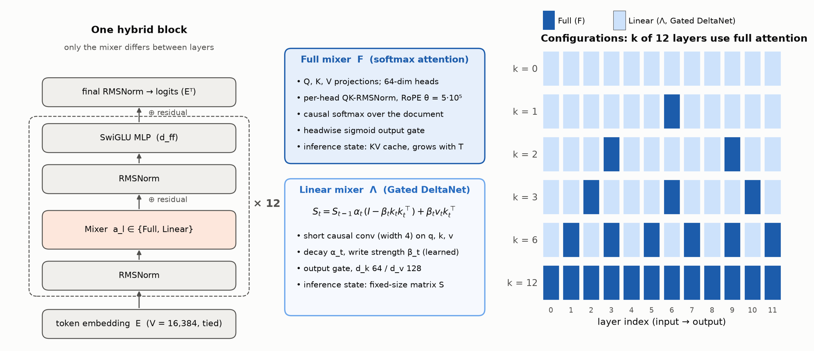
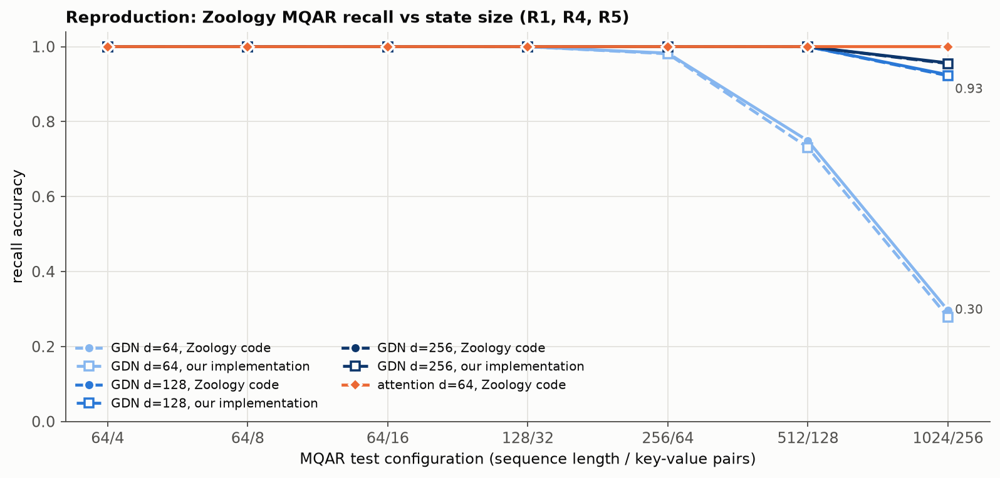

# How Much Full Attention Does Long Context Need?

**A controlled study of hybrid linear/full attention ratios in small language models.**

This IE624 course research project investigates how many full softmax-attention layers a language model needs to retrieve, combine, and aggregate information over long inputs. It compares 12-layer models mixing full attention with Gated DeltaNet, measuring capability alongside inference-state memory and execution cost.

> **Research status: pre-pilot.** Model, data, training, evaluation, and analysis pipelines are implemented, with recorded verification and baseline reproductions. **The main attention-ratio study has not run; hypotheses H1–H6 remain untested.** The latest committed research records place feasibility pilots on hold pending further numerical validation and GPU-stability checks.

## Contents

- [Motivation](#motivation)
- [Architecture](#architecture)
- [Experimental methodology](#experimental-methodology)
- [Completed work and preliminary evidence](#completed-work-and-preliminary-evidence)
- [Development status](#development-status)
- [Repository layout](#repository-layout)
- [Setup and usage](#setup-and-usage)
- [Limitations](#limitations)
- [Further reading and acknowledgements](#further-reading-and-acknowledgements)

## Motivation

Full attention gives each token access to earlier keys and values, but its prefill attention computation grows quadratically with sequence length, and its key–value (KV) cache grows linearly. Linear attention replaces that growing cache with a fixed-size recurrent state. This saves memory at long context, but compressing the past can limit precise recall.

Hybrid architectures combine both mechanisms. This study asks whether a few full-attention layers can recover most of an all-attention model's long-context capability, and whether the answer changes with task, length, or placement.

| Research question | Comparison |
|---|---|
| **Composition** | Vary full-attention count while holding the rest of the training design fixed. |
| **Placement** | Compare early, centred, and late placements at a selected fixed attention count. |
| **Task dependence** | Compare retrieval, multi-hop key chains, and frequency aggregation. |
| **Capability versus cost** | Relate accuracy to analytic state memory and FLOPs, then measured prefill latency and decode throughput. |

The intended contribution is a controlled, length-resolved capability–cost frontier at a small, single-GPU scale. The project extends earlier hybrid-attention and associative-recall work; it does not introduce a new attention operator. The [literature review](reports/literature/literature_review.md) provides the research context.

## Architecture

Every model has 12 pre-norm residual blocks, tied input/output embeddings, RMSNorm, and SwiGLU MLPs. The composition variable is **k**, the number of blocks using full attention; the other **12 − k** use Gated DeltaNet (GDN).



| Component | Implementation |
|---|---|
| Full attention (`A`) | Causal multi-head softmax attention; 64-dimensional heads; per-head QK-RMSNorm; RoPE with θ = 500,000; headwise sigmoid output gate. |
| Linear attention (`-`) | `fla.layers.GatedDeltaNet`; key dimension 64, value dimension 128, output gating, and width-4 short causal convolutions. Recurrent and convolution states use fp32. |
| Shared backbone | Token embeddings, two pre-norm residual sublayers per block, SwiGLU MLP, final RMSNorm, and tied language-model head. |
| Document boundaries | Packed documents have isolated attention/recurrent state and reset position indices. |

### Model family

Both candidate scales use a 16,384-token vocabulary. Feasibility pilots select the scale for the main study.

| Scale | Hidden width | MLP width | Total parameters | Planned Stage-A tokens |
|---|---:|---:|---:|---:|
| D384 | 384 | 1,024 | ≈27.6M | 0.6B |
| D512 | 512 | 1,536 | ≈49.4M | 0.8B |

Non-embedding parameter counts vary by less than 0.14% across the standard composition family. Shared-module initialisation and data order are paired across configurations for each seed. Training compute per token is not matched.

Patterns read from input to output: `A` is full attention and `-` is GDN.

| Configuration | Full layers | Pattern | Planned role |
|---|---:|---|---|
| C0 | 0 | `------------` | Pure linear baseline |
| C1 | 1 | `------A-----` | Minimal-attention anchor |
| C2 | 2 | `---A-----A--` | Extended sweep |
| C3 | 3 | `--A---A---A-` | Primary hybrid anchor |
| C6 | 6 | `-A-A-A-A-A-A` | Extended sweep |
| C12 | 12 | `AAAAAAAAAAAA` | All-attention reference |

Additional configurations implement attention with short convolutions (`X-gc*`), attention without positional encoding (`X-nope*`), wider-state GDN (`X-E*`), and placement variants (`P*`). Optional configurations cover Gated Linear Attention and convolution-free GDN. Their availability does not imply completed experiments; see [model configs](configs/model/) and [layer patterns](src/hybridlc/models/patterns.py).

## Experimental methodology

### Data and training

Training uses **FineWeb-Edu sample-10BT** and **PG19**, pinned to dataset revisions in [sources.py](src/hybridlc/data/sources.py). FineWeb-Edu shards 001–006 supply training text; shard 000 supplies disjoint development/test splits. PG19 uses its train, validation, and test splits. A custom byte-level BPE tokenizer has 16,384 entries and isolates individual digits.

The planned recipe is shared across attention counts:

| Phase | Context | Recipe |
|---|---|---|
| **Stage A: pretraining** | 4,096 tokens | 85% FineWeb-Edu and 15% PG19; 0.6B tokens at D384 or 0.8B at D512. |
| **Stage B: long-context adaptation** | Up to 32,768 tokens | 60% PG19 book windows and 40% FineWeb-Edu; budget and any 16K fallback determined by pilot rules. |
| **Task-exposure fine-tuning (TEF)** | Packed up to 32,768 tokens | Default 90% synthetic tasks and 10% corpus replay; 1,000 steps / 65.5M tokens, with longer-exposure controls and predefined fallback recipes. |

TEF provides exposure to the task format so evaluation can distinguish memory limitations from failure to learn the task at this scale. Training and evaluation use separate word lists and templates.

The optimiser is AdamW with β = (0.9, 0.95), weight decay 0.1, gradient clipping, and z-loss. Training uses bf16 autocast with fp32 master weights. A planned learning-rate sweep selects by held-out language-model loss using minimax regret across C0, C3, and C12. Batches are deterministic functions of seed, stage, and step; atomic checkpoints preserve model, optimiser, and RNG state for resumption.

### Evaluation

Evaluation items are constructed in token space at exact lengths from **1K to 32K**, with SHA-256 manifests. Intended long-context comparisons stay within the selected training context length.

| Family | Task | What it probes |
|---|---|---|
| Retrieval | **R1:** retrieve a fact among distractors; **R-load:** retrieve from increasing numbers of facts | Precise recall and memory load |
| Multi-hop | **M-hop:** follow shuffled key chains, up to four hops | Combining facts across the context |
| Aggregation | **A-freq:** compare frequencies | Accumulating evidence |

**Teacher-forced exact match** is primary; gold-answer log-probability and candidate-rank accuracy are secondary. Scoring prefills each context once and branches queries from a snapshot of its inference state; a subset is checked against single-pass scoring. Diagnostics examine distance, filler, recency, position, and attention behaviour. Separate zero-shot diagnostics cover long-document loss and copying across gaps.

CLI suite names are `CS` (confirmatory), `MS` (mechanistic diagnostics), `FD` (feasibility development), `DG` (decision gate), `DC` (development checks), and `Tier0` (zero-shot diagnostics).

### Hypotheses and analysis

For a task-family score $S_f(k,T)$, normalised recovery is

$$
R_f(k,T)=\frac{S_f(k,T)-S_f(0,T)}{S_f(12,T)-S_f(0,T)}.
$$

Recovery is interpretable only when the all-attention reference is adequate and its gap over the linear baseline is meaningful. Reference-adequacy gates determine which lengths enter the primary analysis, targeting the 16K/32K retrieval cells.

| Hypothesis | Planned test or summary |
|---|---|
| **H1 / H1-min** | Whether three / one full-attention layers recover at least 80% of the retrieval gap. |
| **H2** | Diminishing returns; descriptive curve fits and the count needed for 80% recovery. |
| **H3** | Whether recovery differs between retrieval and multi-hop tasks. |
| **H4** | Whether placement matters at fixed attention count. |
| **H5** | Whether the full-versus-linear gap grows with context length. |
| **H6 / H6′** | Capability–cost frontier and recurrent-state versus KV-cache allocation at matched memory. |

The planned core comparison uses 4–5 paired training seeds per configuration, with a predefined variance-based seed-addition rule. Confirmatory tests use Holm correction; sensitivity analyses include a hierarchical paired bootstrap. Longer TEF and Stage-B controls guard against interpreting undertraining as evidence against H1. Full criteria and amendments are in the [experimental protocol](reports/experimental_protocol.md) and [methodology guide](docs/METHODOLOGY.md).

Analytic costs are primary. For one sequence in the standard family, bf16 KV storage contributes $4kdT$ bytes, while the remaining layers contribute fixed-size fp32 recurrent and convolution states. This excludes weights and temporary activations. [analytic.py](src/hybridlc/models/analytic.py) implements parameter, FLOP, and state-memory accounting; measured benchmarks use explicitly selected backends and report hardware-specific costs.

## Completed work and preliminary evidence

**These results validate components and reproduce baseline behaviour; they do not establish an optimal attention ratio.**

| Validation | Recorded outcome | Evidence |
|---|---|---|
| Zoology multi-query associative recall (MQAR), original models | Reproduction gate passed. Best-over-LR overall accuracy: attention ≥0.9997; GDN 0.989 at width 128 and 0.994 at width 256. | [G-RP](reports/gates/G-RP.md) |
| Project mixers inside Zoology's harness (R4) | Passed: overall accuracy within 0.0004 of the reference across four matched cells. | [R4](reports/reproduction/results_R4.md) |
| Below-ceiling MQAR (R5) | On the 1,024-token / 256-pair cell, reference GDN recall rises from 0.296 to 0.925 to 0.957 at widths 64, 128, and 256. At width 64, the three-seed mean difference for this implementation is −0.0175; power to detect small differences is limited. | [R5](reports/reproduction/results_R5.md) |
| LAMBADA scoring (R7) | GDN-340M accuracy 0.3435 passed its anchor check. Pythia fp32 did not pass as registered; fp16 reproduced published anchors. Independent scoring paths agreed item by item. | [R7](reports/reproduction/results_R7.md) |
| Infrastructure verification | The historical G0 report records 447 passing VT-01–20 tests. Later long-context checks include failures against original tolerances and follow-up checks; this count does not establish that the current full suite passes. | [G0](reports/gates/G0.md), [R3](reports/reproduction/results_R3.md) |



*MQAR validation across sequence length / key–value-pair counts. These small associative-recall models are separate from the planned 12-layer language-model study. The width-64 GDN comparison averages three seeds; wider reference points come from earlier reproduction runs.*

One inference-cost session has been recorded using **randomly initialised models**. Cache sizes agreed with analytic accounting, but the required second session is pending and some measurements were affected by GPU contention. These timings are preliminary implementation measurements, not a completed capability–cost frontier. The [benchmark report](reports/cost_benchmarks_session1.md) details the qualifications and raw data.

## Development status

| Workstream | State in the committed research records |
|---|---|
| Model, data, training, evaluation, and analysis implementation | Implemented, with verification reports and regression tests |
| Baseline reproduction | MQAR gate passed; other checks have qualified outcomes described above |
| Pre-pilot validation | Further precision, oracle, resume, and GPU-stability checks pending; validation gate G-RV remains open |
| Feasibility pilots and learning-rate selection | Planned; not completed |
| Core ratio study, controls, and placement experiments | Planned; no main-study findings |
| Final benchmarking and conclusions | Pending |

The plan proceeds from validation to feasibility pilots, learning-rate selection, a frozen core comparison at **k ∈ {0, 1, 3, 12}**, controls, and evaluation. The **k = 2, 6**, placement, and wider-state experiments form an extended tier. The [experiment plan](configs/experiments/plan.yaml) specifies dependencies and decision rules; the [results ledger](reports/results.md) records completed evidence.

## Repository layout

```text
├── src/hybridlc/
│   ├── models/       Hybrid LM, mixers, caches, analytic costs
│   ├── data/         Corpus pins, tokenizer, token stores, loaders, TEF
│   ├── training/     Configs, trainer, checkpoints, run queue, safeguards
│   ├── eval/         Task generators, frozen items, scoring, diagnostics
│   ├── integration/  Checkpoint evaluation and feasibility-result blinding
│   ├── analysis/     Scores, statistics, gates, verdicts, plotting
│   ├── bench/        Inference benchmark harness
│   └── utils/        Seeds, provenance, GPU coordination, test support
├── configs/          Model families, training recipes, experiment plan
├── scripts/          Data preparation, training, evaluation, reproductions
├── tests/            Verification and regression tests
├── experiments/      Registrations, manifests, registries, recorded outputs
├── reports/          Protocol, literature, validation, results, limitations
├── docs/             Methodology and checked-in figures
├── plots/            Research-figure scripts
├── knowledge/        Supporting research notes
├── pyproject.toml    Package metadata and dependency requirements
└── requirements-lock.txt
```

Large generated artifacts—including corpora, token stores, weights, evaluation `.npz` arrays, and Triton caches—are excluded from Git. A clone contains recorded summaries and manifests but requires preparation before training or evaluation. Generated logs go under `runs/`, weights under `checkpoints/`, and evaluation outputs under `experiments/results/`.

## Setup and usage

### Environment

The recorded environment is **Ubuntu 24.04, Python 3.12, NVIDIA RTX 5080 (16 GB), PyTorch 2.11.0+cu128, Triton 3.6.0, and flash-linear-attention 0.6.0**. Dependencies are pinned in [pyproject.toml](pyproject.toml) and [requirements-lock.txt](requirements-lock.txt). GPU-lock and queue utilities use Unix facilities; these commands target Linux and run from the repository root. Native Windows support is not established.

With Git and `uv` available:

```bash
git clone https://github.com/mr-entr0py/hybrid-attention-longcontext.git
cd hybrid-attention-longcontext
uv venv --python 3.12 .venv
source .venv/bin/activate
uv pip install torch==2.11.0 --index-url https://download.pytorch.org/whl/cu128
uv pip install -r requirements-lock.txt --extra-index-url https://download.pytorch.org/whl/cu128 --index-strategy unsafe-best-match
uv pip install -e . --no-deps
```

These are recorded dependency versions; compatibility with other stacks or GPU architectures has not been established. The default training memory fraction is 0.44 (about 7 GiB on the recorded GPU); see [base.yaml](configs/training/base.yaml) before adapting a run.

### Prepare data and evaluation items

Recorded preparation used approximately **22 GB of raw data and 17 GB of token stores**. Allow additional space for caches, items, and checkpoints. Downloads require Hugging Face access.

```bash
python scripts/data_download.py
python scripts/data_tokenizer.py
python scripts/data_pretokenize.py
python scripts/data_manifest.py
python scripts/make_items.py --suite all --jobs 8
```

These write `data/MANIFEST.json` and per-namespace item manifests under `experiments/items/`. Item generation verifies and skips existing files rather than replacing them. To generate a separate development-only subset:

```bash
python scripts/make_items.py --suite DC --n-max 10 --jobs 1 --out work/items-smoke
```

### Verify the installation

```bash
# Non-GPU, non-slow checks; the test plugin hides CUDA for this selection.
pytest -q tests/ -m "not gpu and not slow"

# Full verification, including GPU and long-running checks.
pytest -q tests/ --junitxml=work/verification.xml
```

The test plugin coordinates the GPU lock and uses a diagnostics Triton cache. The full suite requires CUDA and, for relevant checks, prepared artifacts or reference repositories. Review skips, expected failures, and generated outcome records alongside numerical-validation reports: a successful test-process exit does not establish that every original registered criterion passed.

### Run a training smoke test

After preparing the corpora, this example exercises the real D384/C3 model, data, and loss path for 20 steps. It is an infrastructure check, not a research run.

```bash
python scripts/train.py --config configs/training/examples/smoke_D384_C3.yaml --print-config
python scripts/repro/gpu_lock.py run --label smoke -- \
  python scripts/train.py --config configs/training/examples/smoke_D384_C3.yaml
```

Training resumes from the newest full checkpoint by default. It requires a clean Git tree unless `--allow-dirty` is supplied; that choice is recorded. Config hashes, versions, seed metadata, and run events provide provenance. GPU commands must run through the lock wrapper or inherit a lock from the queue.

For selected run configurations, enqueue explicit paths and inspect the queue before running it:

```bash
python scripts/runner.py enqueue configs/training/examples/smoke_D384_C3.yaml
python scripts/runner.py status
python scripts/runner.py run
```

The queue acquires the GPU lock itself and supports resumption. Checked-in feasibility configurations describe future study runs; their presence does not mean the research gates have cleared.

### Evaluate and analyse

Replace `CHECKPOINT_PATH` with a generated checkpoint. This example scores ten contexts per development-check cell:

```bash
python scripts/repro/gpu_lock.py run --label evaluate -- \
  python scripts/evaluate.py --ckpt CHECKPOINT_PATH --suite DC --n-contexts 10
```

Subset evaluations receive separate labels and are excluded from confirmatory analysis. If using the development-only items above, also pass `--items-root work/items-smoke`.

Once complete confirmatory results and recorded gate outcomes exist, `scripts/analyse_results.py` produces estimates, verdicts, and input hashes. Its `--gates` option accepts a JSON file of actual gate outcomes; missing gates do not count as passed. A separate demonstration exercises analysis without trained checkpoints:

```bash
python scripts/analyse_results.py --synthetic --out work/analysis-demo
```

This demonstration generates artificial data and is not research evidence. For baseline reproduction, consult the [reproduction plan](reports/reproduction/reproduction_plan.md) and [Zoology scripts](scripts/s1_zoology/); reference checkouts and additional dependencies are not bundled. Regenerate checked-in README figures with `python scripts/make_readme_figures.py` from the recorded outputs.

## Limitations

- **No ratio-study conclusions yet.** Reproduction and infrastructure checks do not establish H1–H6.
- **Restricted scope.** Planned conclusions apply to approximately 28–49M-parameter models, these mixers, this recipe, and identical synthetic-task exposure. Transfer to larger models or natural-language tasks is untested.
- **Compute differs.** Parameters and data exposure are closely matched, but attention compute grows with full-attention count and context length.
- **Qualified numerical validation.** Some original long-context checks did not pass as registered. Follow-up checks and residual risks must be assessed before interpreting study results.
- **Implementation-specific timing.** Kernel maturity, backend choice, GPU contention, and the pending second session limit performance comparisons.
- **Limited seed-level power.** Below-ceiling reproduction shows substantial seed variability; small capability differences may remain unresolved.

## Further reading and acknowledgements

| Topic | Reference |
|---|---|
| Design and decision criteria | [Experimental protocol](reports/experimental_protocol.md), [methodology](docs/METHODOLOGY.md) |
| Execution dependencies | [Experiment plan](configs/experiments/plan.yaml), [training examples](configs/training/examples/) |
| Completed evidence | [Results ledger](reports/results.md), [reproduction reports](reports/reproduction/), [gate reports](reports/gates/) |
| Prior work | [Literature review](reports/literature/literature_review.md), [structured bibliography](reports/literature/literature_db.yaml) |
| Threats to interpretation | [Competing explanations](reports/competing_explanations.md), [evaluation audit](reports/audits/evaluation_audit.md) |

The implementation and validation build on [flash-linear-attention](https://github.com/fla-org/flash-linear-attention), [Zoology](https://github.com/HazyResearch/zoology), [RULER](https://github.com/NVIDIA/RULER), and the [EleutherAI language-model evaluation harness](https://github.com/EleutherAI/lm-evaluation-harness). The literature review attributes the Gated DeltaNet, hybrid-model, and associative-recall research informing the study.
